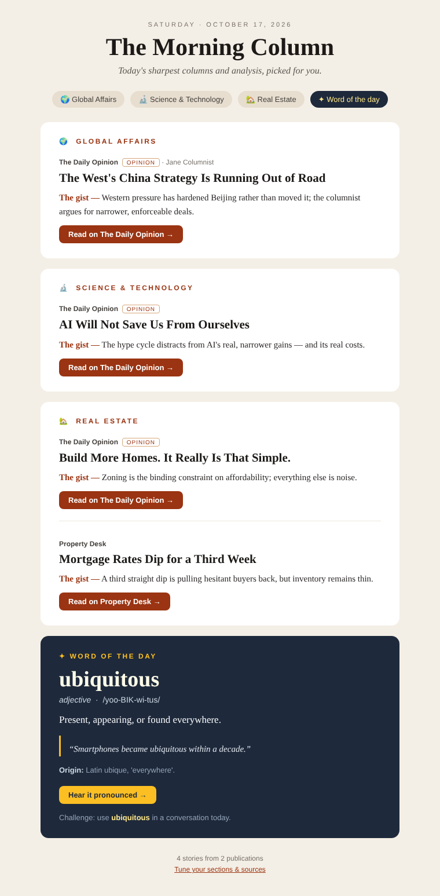

# news-aggregator

A personal morning newsletter. Every day it collects opinion columns and analysis from
major newspapers, picks the ones that match your interests, and emails you a styled digest
with a word of the day. Every headline links to the original article.

**Sources:** The New York Times, The Washington Post, The Wall Street Journal, The Guardian,
Financial Times, The Economist, The Atlantic, Los Angeles Times, The New Yorker and
Foreign Affairs. Opinion desks plus their section feeds.

**Default sections:** 🌍 Global Affairs · 🔬 Science & Technology · 🏡 Real Estate



## How it works

```
RSS feeds ──► fetch ──► dedupe + keyword scoring ──► (optional) Claude picks & annotates ──► HTML email ──► Gmail SMTP
                         per-section weights,              using your reader profile
                         opinion boost, freshness
```

- **Personalisation.** Edit `config.yaml`: section weights, keywords, the free-text
  `reader_profile`, and the sources list. Stories from mixed feeds such as *Opinion* are
  put into a section by keyword. Stories that fit no section are dropped.
- **Claude curation (optional).** If `ANTHROPIC_API_KEY` is set, Claude picks the best
  pieces for your profile and writes a one-line "The gist" takeaway for each. It also
  picks a word of the day that appears in one of today's stories, with a link to that
  story. Without a key, the digest uses keyword ranking and a built-in rotating word list.
- **Delivery.** A GitHub Actions workflow (`.github/workflows/daily-digest.yml`) runs
  every morning and sends the email over SMTP.

## Setup (about 5 minutes)

1. **Create a Gmail app password.** Your Google account needs 2-Step Verification. Then go to
   <https://myaccount.google.com/apppasswords>, create an app password named
   "news digest", and copy the 16-character password.
2. **Add repository secrets.** Go to *Settings → Secrets and variables → Actions → New repository secret*:

   | Secret | Value |
   |---|---|
   | `SMTP_USER` | Your Gmail address (the sender) |
   | `SMTP_PASSWORD` | The app password from step 1 |
   | `DIGEST_TO` | Where to deliver the digest (can be the same address) |
   | `ANTHROPIC_API_KEY` | *Optional.* Turns on Claude curation, takeaways and contextual words |

3. **Test it.** Go to *Actions → Daily digest → Run workflow*. Tick *dry run* to only build
   the email, which you can download from the run's artifacts. Leave it unticked to send it.
4. After that it runs on its own every day at **11:07 UTC** (about 7am New York time). To
   change the time, edit the `cron` line in the workflow. GitHub cron uses UTC.

To use a provider other than Gmail, set `SMTP_HOST` and `SMTP_PORT` as extra env vars in
the workflow. Port 465 uses SSL; any other port uses STARTTLS.

## Run locally

```bash
pip install -r requirements.txt
python -m digest --dry-run          # writes out/digest.html; open it in a browser
SMTP_USER=... SMTP_PASSWORD=... DIGEST_TO=... python -m digest   # send for real
pip install pytest && python -m pytest
```

## Customising

- **Add a section.** Add a block under `sections:` (with `label`, `emoji`, `weight`,
  `keywords`). Optionally pin feeds to it with `section: <key>`.
- **Favour a topic.** Raise its `weight`, for example `1.5`.
- **More or fewer stories.** Change `digest.stories_per_section`.
- **Add a paper.** Append an RSS URL under `sources:`. Mark columns with `opinion: true`.
- **Model.** Defaults to `claude-opus-5-5`. Override it with the `DIGEST_MODEL` env var.

Some publications (WSJ, FT, The Economist) are paywalled. The digest links to them, but
reading the full article may need a subscription.
